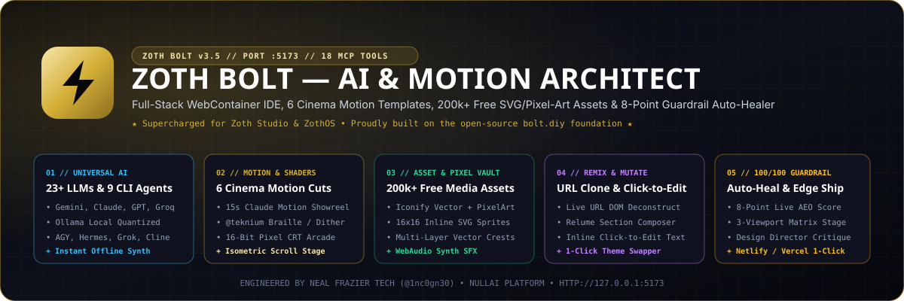

<div align="center">
  
</div>

<br />

<div align="center">
  <a href="https://zoth.nullai.tech/webgen"></a>
  <a href="https://github.com/stackblitz-labs/bolt.diy"></a>
  <a href="https://zoth.nullai.tech"></a>
  <a href="https://zothos.nullai.tech"></a>
</div>

# ⚡ Zoth Bolt — Full-Stack AI & Motion Architect (`:5173`)

> **Where Sovereign Software & High-Craft Motion Begin.**  
> **Zoth Bolt** is the primary Full-Stack AI, Motion Edit, and WebContainer IDE inside **[Zoth Studio v2](https://zoth.nullai.tech)** and **[ZothOS Linux 3.3](https://zothos.nullai.tech)** — proudly built upon the open-source **[`bolt.diy`](https://github.com/stackblitz-labs/bolt.diy)** foundation and supercharged into an Awwwards-grade creation powerhouse by **Neal Frazier Tech ([@1nc0gn30](https://github.com/1nc0gn30))**.

---

## 🏆 Head-to-Head vs. Cloud AI Website Builders

| Capability | v0 (Vercel) | Lovable.dev | Bolt.new | Replit Agent | Framer AI / Relume | **⚡ Zoth Bolt (`:5173`) + QuickSite (`:8092`)** |
| :--- | :---: | :---: | :---: | :---: | :---: | :---: |
| **AI Provider Freedom** | Locked | Locked | Locked | Locked | Locked | **23+ Cloud Providers + Ollama + 9 Local CLI Agents (`agy`, `hermes`, `grok`, `claude`, `opencode`, `cline`, `aider`, `codex`, `gemini`)** |
| **Motion Graphics & Shaders** | Basic CSS | Basic CSS | Basic CSS | None | Scroll Presets | **6 Cinema Motion Templates + 60fps `@teknium` Braille/Dither/ASCII Shaders + 15s Showreel Engine** |
| **Built-In Asset & Icon Vault** | Lucide only | Lucide only | Lucide only | Basic | Basic | **200k+ Live Iconify SVGs + 16-Bit Pixel Art Sprites + Multi-Layer Vector Crests + WebAudio SFX** |
| **Live URL Clone / Remix** | Screenshot | Plugins | Via Same.new | Partial | No | **Native `/api/zoth/url-blueprint` DOM, Palette & Typography Deconstructor** |
| **Visual Section Composer** | No | No | No | No | **Yes (Relume)** | **Interactive Section Stack Composer + Curated Avant-Garde Font/Palette Tokens** |
| **Visual Click-to-Edit Mode** | Design Mode | Visual Edit | No | No | Yes | **Inline `contentEditable` Click-to-Edit DOM Mutator + 1-Click Live Theme Swapper** |
| **Live SEO/AEO Guardrail & Auto-Fix** | No | Partial | Console only | Self-test | Basic SEO | **8-Point Sovereign Guardrail Auditor (`100/100`) + 1-Click Auto-Healer + Design Director Rubric** |
| **Triple-Viewport Matrix (`375`/`768`/`1280`)** | Single | Single | Single | Single | **Yes** | **Simultaneous 3-Viewport Responsive Matrix Stage** |

---

## 💎 Core Capabilities

### 1. Universal AI Providers, Local Ollama & 9 Local CLI Agents
Run Zoth Bolt with **zero vendor lock-in**:
- **Cloud Providers (23+)**: Google Gemini (`gemini-2.5-flash`, `gemini-2.5-pro`), Anthropic Claude, OpenAI, OpenRouter, DeepSeek, Groq, xAI Grok, Mistral, Cohere, Together, Perplexity, Fireworks, Cerebras, Amazon Bedrock.
- **Local Model Servers**: Ollama (`127.0.0.1:11434`), LM Studio, OpenAI-like local endpoints.
- **Local Sovereign CLI Agents (`ZothLocal` Provider)**:
  - `zoth-bolt-instant` — Instant deterministic HTML5/SVG/Motion Synthesizer (`<50ms`, zero API keys required)
  - `agy` — Google Antigravity CLI Agent
  - `hermes` — Hermes Autonomous Agent (`~/.hermes`)
  - `grok-cli` — Grok Bot CLI
  - `claude-cli` — Claude Code CLI
  - `opencode` — OpenCode CLI
  - `cline` — Cline Autonomous CLI
  - `aider` — Aider Pair Programmer
  - `codex-cli` & `gemini-cli`

### 2. 🎬 6 Production Motion Edit & `@teknium` Uncommon Web Shader Templates
Every site can be seeded with deterministic 60fps choreography:
1. **`claude-15s-showreel`** — 15-Second 6-Scene Claude Motion Launch Showreel with timeline scrubber & aperture handoff
2. **`teknium-uncommon-shader`** — `@teknium` 60fps HTML5 Canvas Shader Stage (Unicode Braille Wave `U+2800`, Bayer 4x4 Ordered Dither, Kinetic ASCII Matrix)
3. **`gameboy-pixel-cinema`** — 16-Bit Pixel Art & Retro CRT Phosphor Arcade (`shape-rendering="crispEdges"` 16x16 sprites + WebAudio 8-bit chiptune synth)
4. **`hermes-commerce-drop`** — Instant 15-Minute Neighborhood Commerce & Delivery Drop (`Sprig`, `Hatch`, `Hush`) with animated SVG ETA ring
5. **`scroll-choreography-deck`** — 3D Isometric Multi-Layer SVG Exploded View with interactive layer-separation slider
6. **`sovereign-saas-funnel`** — Sovereign Micro-SaaS Utility with real client-side AST/linter gauges + Dual Stripe & Solana DePay funnel

### 3. 🛡️ 200,000+ Free Icons, 16-Bit Pixel Art SVGs & Bespoke Vector Crests
Open the **Command Vault (`Assets & Motion` button in the header)** to search and inject:
- **Live Iconify Search**: 200,000+ free SVG icons across `pixelarticons`, `lucide`, `ph`, `game-icons`, and `simple-icons`
- **Built-In 16x16 Pixel Art SVGs**: Sovereign Crown, Golden Bolt, Aegis Shield, Pixel Potion, Relic Blade, Autonomous Bot, Emerald Gem, Pixel Flame
- **Multi-Layer Vector Crests**: Alchemical Hex-Core, Botanical Emerald Seal, Nocturnal Velvet Crest, Isometric Compute Cube
- **Zero-Key DiceBear Pixel-Art Character Sprite Generator** & **WebAudio Procedural Sound FX**

### 4. 🔗 Live URL Deconstructor, Relume Section Composer & 100/100 Guardrail Auto-Healer
- **`POST /api/zoth/url-blueprint`**: Fetches any live website, extracts its headings, navigation, color hex swatches, and typography, and generates a 1-click Zoth Bolt redesign prompt.
- **`POST /api/zoth/self-critique`**: Scores any HTML/app against the 100-point Design Director rubric (`Hierarchy`, `Responsiveness`, `Visual Craft`, `Interactivity`, `AEO & Conversion`) and auto-polishes CSS with fluid `clamp()` typography and overflow guards.
- **`ZothGuardrailBar`**: Live 8-point scoreboard in the Workbench with **1-Click "🛠️ Auto-Heal to 100/100 Guardrail"** (automatically writes `public/robots.txt`, `netlify.toml`, `Schema.org @graph` JSON-LD, OpenGraph headers, and Sovereign Attribution).

---

## 🔌 18-Tool Model Context Protocol (MCP) Server

Connect Claude Code, Cursor, Antigravity (`agy`), Cline, or Hermes directly to Zoth Bolt via `packages/mcp-server/index.mjs`:

```json
{
  "mcpServers": {
    "zoth-bolt": {
      "command": "node",
      "args": ["/home/zoth/NullAITech/bolt.diy/packages/mcp-server/index.mjs"],
      "env": {
        "WEBGEN_BASE_URL": "http://127.0.0.1:5173"
      }
    }
  }
}
```

**Available MCP Tools (18)**:
- `zoth_bolt_search_free_icons` • `zoth_bolt_get_svg_pixel_library` • `zoth_bolt_list_motion_templates` • `zoth_bolt_deconstruct_live_url` • `zoth_bolt_self_critique_and_polish`
- `webgen_set_prompt` • `webgen_trigger_submit` • `webgen_prompt_and_build` • `webgen_run_tool` • `webgen_select_framework` • `webgen_apply_design_preset` • `webgen_get_design_catalog` • `webgen_insert_media_pack` • `webgen_get_status` • `webgen_list_files` • `webgen_read_file` • `webgen_write_file` • `webgen_get_preview_url`

---

## 🚀 Quick Start

```bash
cd ~/NullAITech/bolt.diy
pnpm install
pnpm run dev
# Opens on http://127.0.0.1:5173 (or inside Zoth Studio at http://127.0.0.1:3000/webgen)
```

---

## 📜 Open-Source Lineage & Attribution

- **Engineered by**: **Neal Frazier Tech ([@1nc0gn30](https://github.com/1nc0gn30))** • **[NullAI Platform](https://nullai.tech)**
- **Open-Source Foundation**: Proudly built on the open-source **[`bolt.diy`](https://github.com/stackblitz-labs/bolt.diy)** project (MIT License) and heavily expanded for **[Zoth Studio v2](https://zoth.nullai.tech)** and **[ZothOS Linux 3.3](https://zothos.nullai.tech)**.
